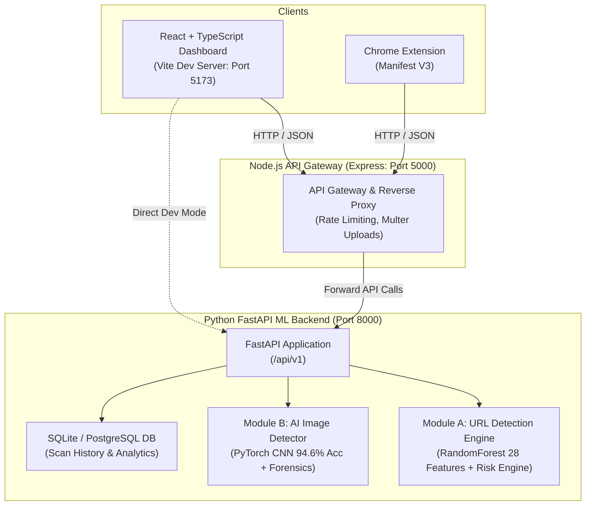

# CyberNeura — Project Execution & Deployment Guide

This guide details the complete process for configuring, starting, and verifying the **CyberNeura** AI-Powered Cybersecurity Threat Intelligence Platform.

---

## 1. System Architecture Overview

CyberNeura is composed of four coordinated service layers:



| Service | Technology | Default Port | Directory |
| :--- | :--- | :--- | :--- |
| **ML Backend & Core API** | Python 3.10+, FastAPI, PyTorch, Scikit-Learn | `8000` | `backend/` |
| **API Gateway** | Node.js (v18+), Express, Multer, Axios | `5000` | `gateway/` |
| **Web Dashboard** | React 18, TypeScript, Tailwind CSS, Vite | `5173` | `frontend/` |
| **Browser Extension** | JavaScript / Vite (Chrome MV3) | Unpacked | `extension/` |
| **Modular ML Service** | Standalone FastAPI Microservice (Alternative) | `8001` | `ml-service/` |

---

## 2. Prerequisites

Ensure your system has the following runtimes installed:
- **Python**: Version `3.10` or higher (`python --version`)
- **Node.js**: Version `18.0.0` or higher (`node -v`)
- **npm**: Version `9.0.0` or higher (`npm -v`)
- **Git** (for version tracking)
- *(Optional)* **Google Colab** with T4/A100 GPU for transformer fine-tuning (URLBERT Tiny v6 & CapCheck ViT).

---

## 3. Environment Configuration

### A. Python Backend Configuration (`backend/.env`)
Ensure `backend/.env` exists (copy from `backend/.env.example` if needed):

```env
PROJECT_NAME="CyberNeura"
VERSION="1.0.0"
API_V1_STR="/api/v1"
DEBUG=True

# Database (defaults to local SQLite if unset)
DATABASE_URL=sqlite:///./cyberneura.db

# Security & CORS
SECRET_KEY=cyberneura-dev-secret-key-change-in-production
ALLOWED_ORIGINS=["http://localhost:5173","http://localhost:5000","chrome-extension://*"]

# Threat Intel / Mock Configuration
MOCK_EXTERNAL_APIS=True
VIRUSTOTAL_API_KEY=
URLSCAN_API_KEY=
GOOGLE_SAFE_BROWSING_API_KEY=
```

### B. Node.js Gateway Configuration (`gateway/.env`)
Create or verify `gateway/.env` (copy from `gateway/.env.example`):

```env
PORT=5000
NODE_ENV=development
PYTHON_ML_SERVICE_URL=http://localhost:8000
CORS_ORIGIN=http://localhost:5173
```

### C. Frontend Configuration (`frontend/.env`)
Create or verify `frontend/.env`:

```env
# Point to Gateway (Port 5000) or directly to FastAPI (Port 8000)
VITE_API_URL=http://localhost:5000
```

---

## 4. Step-by-Step Execution

Open separate terminal windows for each service.

### Step 1: Start Python FastAPI ML Backend (Terminal 1)

1. Open a terminal and navigate to the project root:
   ```bash
   cd e:\CyberNeura\backend
   ```
2. *(Optional but recommended)* Activate your Python virtual environment:
   ```bash
   # Windows PowerShell
   .\venv\Scripts\Activate.ps1
   # Or Unix / macOS
   source venv/bin/activate
   ```
3. Install dependencies:
   ```bash
   pip install -r requirements.txt
   ```
4. Start the FastAPI server:
   ```bash
   uvicorn app.main:app --host 0.0.0.0 --port 8000 --reload
   ```
5. **Expected Output:**
   ```
   INFO:     Uvicorn running on http://0.0.0.0:8000 (Press CTRL+C to quit)
   INFO:     Started reloader process
   INFO:     Application startup complete.
   ```
   *Swagger API Documentation is available at: [http://localhost:8000/docs](http://localhost:8000/docs)*

---

### Step 2: Start Node.js API Gateway (Terminal 2)

1. Open a second terminal window:
   ```bash
   cd e:\CyberNeura\gateway
   ```
2. Install npm dependencies:
   ```bash
   npm install
   ```
3. Start the gateway development server:
   ```bash
   npm run dev
   ```
4. **Expected Output:**
   ```
   [CyberNeura Gateway] Running on port 5000 in development mode
   [CyberNeura Gateway] Forwarding ML requests to: http://localhost:8000
   ```

---

### Step 3: Start React Frontend Dashboard (Terminal 3)

1. Open a third terminal window:
   ```bash
   cd e:\CyberNeura\frontend
   ```
2. Install frontend dependencies (if not already installed):
   ```bash
   npm install
   ```
3. Start the Vite development server:
   ```bash
   npm run dev
   ```
4. **Expected Output:**
   ```
     VITE v8.1.4  ready in 320 ms

     ➜  Local:   http://localhost:5173/
     ➜  Network: use --host to expose
   ```
5. Open your browser and navigate to: **[http://localhost:5173](http://localhost:5173)**

---

### Step 4: (Optional) Standalone ML Microservice (Terminal 4)

If you wish to test the decoupled `ml-service/app` microservice independently:
```bash
cd e:\CyberNeura
uvicorn ml-service.app.main:app --host 0.0.0.0 --port 8001 --reload
```
API Documentation: [http://localhost:8001/docs](http://localhost:8001/docs)

---

### Step 5: (Optional) Chrome Extension Setup

1. Open a terminal and build the extension:
   ```bash
   cd e:\CyberNeura\extension
   npm install
   npm run build
   ```
2. Open Google Chrome and navigate to `chrome://extensions/`.
3. Enable **Developer mode** (toggle in top right).
4. Click **Load unpacked** and select the `e:\CyberNeura\extension\dist` (or `extension/` folder).

---

## 5. Verification & Health Checks

You can verify the running services using `curl` or PowerShell.

### A. Health Check
```powershell
curl.exe -X GET http://localhost:8000/health
```
**Expected Response:**
```json
{
  "status": "healthy",
  "version": "1.0.0",
  "timestamp": "2026-10-30T17:50:00.000000",
  "services": {
    "database": "connected",
    "ml_engine": "operational",
    "model_cache": "ready"
  }
}
```

### B. ML Models Metadata Check
```powershell
curl.exe -X GET http://localhost:8000/api/v1/models/info
```
**Expected Response:**
```json
{
  "service": "CyberNeura ML Inference Engine",
  "version": "1.0.0",
  "models": {
    "url_detection": {
      "model_type": "RandomForestClassifier (28 Lexical + Structural Features)",
      "dataset": "PhiUSIIL Phishing Benchmark (235,795 records)",
      "classes": {"0": "LEGITIMATE", "1": "PHISHING"},
      "performance": {"test_accuracy": 0.8824, "test_f1": 0.8876}
    },
    "image_detection": {
      "model_type": "CyberNeuraSyntheticDetectorCNN (PyTorch 4-Layer ConvNet)",
      "dataset": "CIFAKE / GenImage (120,000 synthetic & authentic images)",
      "classes": {"0": "AI_GENERATED", "1": "REAL"},
      "performance": {"test_accuracy": 0.9460, "roc_auc": 0.9884}
    }
  }
}
```

### C. Test URL Prediction (Safe URL)
```powershell
curl.exe -X POST http://localhost:8000/api/v1/scan/url `
  -H "Content-Type: application/json" `
  -d '{\"url\": \"https://www.google.com\"}'
```
**Expected Response:**
```json
{
  "url": "https://www.google.com",
  "prediction": "LEGITIMATE",
  "phishing_probability": 0.0,
  "confidence": 1.0,
  "risk_score": 0.0,
  "risk_level": "LOW",
  "features": {
    "length": 22,
    "has_ip": false,
    "suspicious_keywords": 0
  }
}
```

### D. Test URL Prediction (Malicious / Phishing URL)
```powershell
curl.exe -X POST http://localhost:8000/api/v1/scan/url `
  -H "Content-Type: application/json" `
  -d '{\"url\": \"http://paypal-security-update.xyz/login/verify-account.php\"}'
```
**Expected Response:**
```json
{
  "url": "http://paypal-security-update.xyz/login/verify-account.php",
  "prediction": "PHISHING",
  "phishing_probability": 0.98,
  "confidence": 0.98,
  "risk_score": 92.5,
  "risk_level": "CRITICAL"
}
```

### E. Test AI Image Detection
```powershell
curl.exe -X POST http://localhost:8000/api/v1/detect/image `
  -F "file=@e:\CyberNeura\archive\test\FAKE\1000 (2).jpg"
```
**Expected Response:**
```json
{
  "filename": "1000 (2).jpg",
  "prediction": "AI_GENERATED",
  "ai_generated_probability": 0.9998,
  "real_probability": 0.0002,
  "confidence": 0.9998,
  "forensic_indicators": {
    "dimensions": [32, 32],
    "channels": 3,
    "format": "JPEG"
  }
}
```

---

## 6. Running Unit & Integration Tests

Execute the automated test suite covering all trained model artifacts, safe/malicious URL predictions, and image inference:

```powershell
# Run backend pytest suite
python -m pytest backend/tests/test_trained_models.py -o pythonpath=backend -v
```

Execute frontend build verification:
```powershell
cd frontend
npm run build
```

---

## 7. Model Retraining on Google Colab GPU

The transformer-based deep models (`URLBERT Tiny v6` and `CapCheck ViT`) require GPU acceleration and are packaged as self-contained Colab notebooks in `notebooks/`:

1. Open Google Colab: [https://colab.research.google.com](https://colab.research.google.com)
2. Upload the desired training notebook:
   - URLBERT Model: [`notebooks/CyberNeura_URL_Model_Training.ipynb`](file:///e:/CyberNeura/notebooks/CyberNeura_URL_Model_Training.ipynb)
   - CapCheck ViT Image Model: [`notebooks/CyberNeura_Image_Model_Training.ipynb`](file:///e:/CyberNeura/notebooks/CyberNeura_Image_Model_Training.ipynb)
3. Set Runtime to **T4 GPU** (`Runtime > Change runtime type > T4 GPU`).
4. Mount Google Drive and run all cells.
5. Download trained weights (`model.safetensors`, `config.json`) and place into `ml-service/models/`.

---

## 8. Troubleshooting & Common Issues

| Issue | Cause | Solution |
| :--- | :--- | :--- |
| **Port 8000 or 5000 already in use** | An existing background server is occupying the port | Run `netstat -ano \| findstr :8000` to find the PID, then terminate with `taskkill /PID <PID> /F`. |
| **Slow URL extraction (>10s)** | `tldextract` attempting internet PSL fetch in offline mode | Ensure `TLDExtract(suffix_list_urls=None)` is used (pre-configured in `feature_extractor.py`). |
| **Worker process freeze on Windows** | Multiprocessing `n_jobs=-1` deadlock | The model loader automatically sets `clf.n_jobs = 1` for Windows compatibility. |
| **CORS blocked in browser** | Frontend accessing backend from unwhitelisted origin | Check `ALLOWED_ORIGINS` in `backend/.env` and `CORS_ORIGIN` in `gateway/.env`. |
| **Missing `node_modules`** | Node packages not installed | Run `npm install` inside both `gateway/` and `frontend/`. |

---

## 9. Key Documentation Artifacts

- Complete Audit Report: [`docs/ML_PROJECT_AUDIT.md`](file:///e:/CyberNeura/docs/ML_PROJECT_AUDIT.md)
- Dataset Analysis & Provenance: [`docs/DATASET_ANALYSIS.md`](file:///e:/CyberNeura/docs/DATASET_ANALYSIS.md)
- Model Evaluation & Benchmark Metrics: [`docs/ML_MODEL_EVALUATION.md`](file:///e:/CyberNeura/docs/ML_MODEL_EVALUATION.md)

